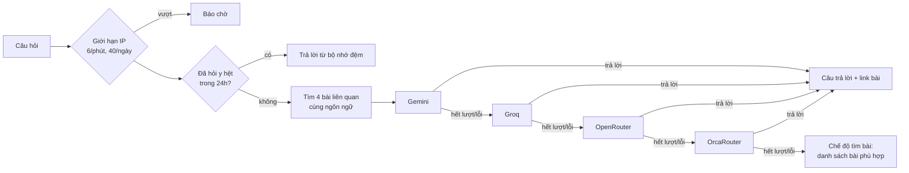

# Trợ lý du lịch (chatbot) — miễn phí

Nút **"Hỏi trợ lý"** ở góc phải mọi trang mở khung chat trả lời về du lịch Khánh Hòa. Câu trả lời
dựa trên các bài review của site và luôn kèm link bài. Trang tiếng Việt trả lời tiếng Việt,
trang `/en/` trả lời tiếng Anh.

## Cách hoạt động

- Chỉ những dịch vụ **có key** mới được gọi. Không có key nào thì bot chạy ở chế độ tìm bài, không lỗi.
- Không lưu nội dung chat trên máy chủ. Lịch sử chat chỉ nằm trong tab trình duyệt của người dùng.
- Code: `theme/toplist-khanh-hoa/inc/chatbot.php` (API `POST /wp-json/tkh/v1/chat`),
  `parts/chatbot.php` (khung chat), `assets/js/chat.js`.

## Lấy key miễn phí

Không cần thẻ thanh toán. Cần **ít nhất 1 key**; càng nhiều key thì càng nhiều lượt mỗi ngày.

| Biến môi trường | Lấy ở đâu | Hạn mức free (tham khảo, 10/2026) |
|---|---|---|
| `GEMINI_API_KEY` | aistudio.google.com → **Get API key** → **Create API key** | Vài trăm – ~1.000 lượt/ngày với Flash-Lite; xem đúng số ở aistudio.google.com/rate-limit |
| `GROQ_API_KEY` | console.groq.com → **API Keys** → **Create API Key** | ~1.000 lượt/ngày với Llama 3.3 70B |
| `OPENROUTER_API_KEY` | openrouter.ai → **Keys** → **Create Key** | 50 lượt/ngày (1.000 nếu từng nạp ≥10$) |
| `ORCAROUTER_API_KEY` | orcarouter.ai → Dashboard → **API Keys** | 50 lượt/ngày, 10 lượt/phút |

Hạn mức do các bên cung cấp quyết định và có thể đổi bất cứ lúc nào.

## Đặt key vào Render

1. Render → service **toplist-khanh-hoa** → **Environment** → **Add Environment Variable**.
2. Key: `GEMINI_API_KEY`, Value: dán key → **Save Changes**. Render tự khởi động lại site.
3. Lặp lại với các key khác nếu có.

Chỉ dán key vào Render, **không đưa vào code, GitHub hay khung chat**.

## Đổi model (không bắt buộc)

| Biến | Mặc định |
|---|---|
| `GEMINI_MODEL` | `gemini-flash-lite-latest` |
| `GROQ_MODEL` | `llama-3.3-70b-versatile` |
| `OPENROUTER_MODEL` | `openrouter/free` (tự chọn model free còn chạy) |
| `ORCAROUTER_MODEL` | `orcarouter/free` |

Khi một nhà cung cấp đổi tên model, chỉ cần sửa biến tương ứng trên Render.

## Kiểm tra nhanh

- Mở site → **Hỏi trợ lý** → chọn câu gợi ý. Câu trả lời có link bài là AI đang chạy.
  Chỉ thấy "Đây là những bài viết phù hợp nhất…" kèm danh sách là đang ở chế độ tìm bài:
  chưa có key, key sai, hoặc mọi dịch vụ đã hết lượt trong ngày.
- Giới hạn chống lạm dụng nằm ở đầu `inc/chatbot.php` (`TKH_CHAT_PER_MINUTE`, `TKH_CHAT_PER_DAY`).
