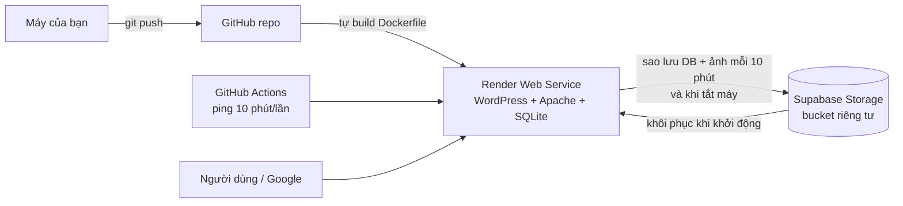

# Đưa website lên mạng miễn phí: GitHub + Render + Supabase

Không cần mua hosting hay tên miền. Kết quả: website WordPress chạy tại
`https://<tên-service>.onrender.com`, dữ liệu được sao lưu sang Supabase.

## Kiến trúc



| Thành phần | Vai trò | Gói |
|---|---|---|
| **GitHub** | Lưu mã nguồn; mỗi lần push, Render tự deploy; Actions giữ site không "ngủ" | Free |
| **Render** | Chạy container WordPress (Dockerfile), cấp HTTPS + tên miền `onrender.com` | Free web service |
| **Supabase** | Storage lưu bản sao database SQLite và thư mục ảnh tải lên | Free |

Vì sao không dùng thẳng database của Supabase? Supabase là PostgreSQL, còn WordPress chỉ hỗ trợ
chính thức MySQL/MariaDB và SQLite. Dùng SQLite (plugin chính thức của WordPress) kèm sao lưu lên
Supabase Storage ổn định hơn nhiều so với các lớp chuyển đổi MySQL→PostgreSQL.

## Bước 1 — Đưa mã nguồn lên GitHub

1. Tạo tài khoản tại github.com (nếu chưa có) và tạo repo mới, ví dụ `toplist-khanh-hoa`.
   Nên để **Public** để GitHub Actions không giới hạn số phút chạy.
2. Cài Git (git-scm.com) hoặc GitHub Desktop, rồi trong thư mục `khanh-hoa-tourism`:

```bash
git init
git add .
git commit -m "feat: bilingual travel site with render deploy"
git branch -M main
git remote add origin https://github.com/<tài-khoản>/toplist-khanh-hoa.git
git push -u origin main
```

## Bước 2 — Tạo Supabase project

1. Đăng ký tại supabase.com → **New project** (chọn region Singapore cho gần Việt Nam).
2. Vào **Project Settings → API Keys** và chép:
   - **Project URL**, dạng `https://abcd1234.supabase.co`
   - **Secret key** (`sb_secret_…`) hoặc khóa **service_role** ở tab *Legacy API keys*.
   Khóa này có toàn quyền, chỉ dán vào Render, không đưa lên GitHub.
3. Không cần tạo bucket, script khởi động tự tạo bucket riêng tư `wordpress-backup`.

## Bước 3 — Deploy lên Render

1. Đăng ký tại render.com bằng tài khoản GitHub.
2. **New → Blueprint** → chọn repo vừa push. Render đọc `render.yaml` và tạo service `toplist-khanh-hoa` (gói Free, máy chủ Singapore).
3. Điền các biến môi trường mà Render hỏi:

| Biến | Giá trị |
|---|---|
| `WP_ADMIN_EMAIL` | Email quản trị |
| `WP_CONTACT_EMAIL` | Email hiển thị ở chân trang (có thể bỏ trống) |
| `SUPABASE_URL` | Project URL ở bước 2 |
| `SUPABASE_SERVICE_KEY` | Secret key ở bước 2 |

   `WP_SALT` và `WP_ADMIN_PASSWORD` được Render tự sinh ngẫu nhiên.
4. **Apply**. Lần build đầu mất khoảng 5–10 phút. Khi log có dòng `backup uploaded to Supabase Storage` là xong.
5. Mở `https://toplist-khanh-hoa.onrender.com` (tên thật hiện ở đầu trang service).
6. Đăng nhập `/wp-admin` với user `admin`. Mật khẩu xem ở **Environment → WP_ADMIN_PASSWORD** trong Render.

Lần khởi động đầu, container tự cài WordPress, kích hoạt Polylang + theme, tải gói tiếng Việt
và nhập 20 bài × 2 ngôn ngữ. Các lần sau, nó khôi phục dữ liệu mới nhất từ Supabase.

## Bước 4 — Giữ site luôn "thức"

Gói Free của Render cho service ngủ sau ~15 phút không có truy cập, lần mở lại mất khoảng 1 phút.
Repo đã có workflow `.github/workflows/keep-alive.yml` ping site mỗi 10 phút:

- GitHub repo → **Settings → Secrets and variables → Actions → Variables → New variable**
- Tên `SITE_URL`, giá trị `https://toplist-khanh-hoa.onrender.com`

(Cách khác: tạo job miễn phí trên cron-job.org gọi URL trên mỗi 10 phút.)

## Bước 5 — Đưa site lên Google

1. Google Search Console → thêm *URL prefix* `https://…onrender.com` → chọn xác minh bằng **thẻ HTML**.
2. Trong WordPress: **Giao diện → Tùy biến → SEO** → dán mã xác minh → Đăng.
3. Bấm Xác minh trong Search Console, rồi gửi sitemap: `wp-sitemap.xml`.

## Vận hành

- **Sửa giao diện / thêm plugin:** sửa code rồi `git push`; Render tự build lại. Dữ liệu vẫn còn nhờ sao lưu.
- **Viết bài, đổi cài đặt:** làm trong wp-admin như bình thường; dữ liệu được sao lưu sau tối đa 10 phút
  (biến `BACKUP_INTERVAL`) và một lần nữa khi Render tắt hoặc deploy lại container.
- **Nạp lại dữ liệu mẫu:** wp-admin → **Công cụ → Dữ liệu mẫu**.
- **Làm lại từ đầu:** xóa 2 file trong bucket `wordpress-backup` trên Supabase rồi *Manual Deploy* trên Render.

## Giới hạn của gói miễn phí

- Render Free: 512 MB RAM, 750 giờ/tháng (đủ cho 1 service chạy liên tục), cold start ~1 phút nếu không ping.
- Nếu container bị dừng đột ngột (không qua SIGTERM), thay đổi trong vòng ≤10 phút cuối có thể mất.
- Supabase Free tạm dừng project sau 7 ngày không có truy cập API. Script tự sao lưu mỗi 6 giờ nên project luôn có hoạt động.
- Bucket Free giới hạn 50 MB mỗi file: đủ cho database và vài trăm ảnh đã nén. Site nhiều ảnh nên dùng ảnh WebP hoặc CDN.
- Tên miền dạng `*.onrender.com`. Khi có tên miền riêng, thêm vào Render (Settings → Custom Domains) và đặt biến `WP_HOME`.
